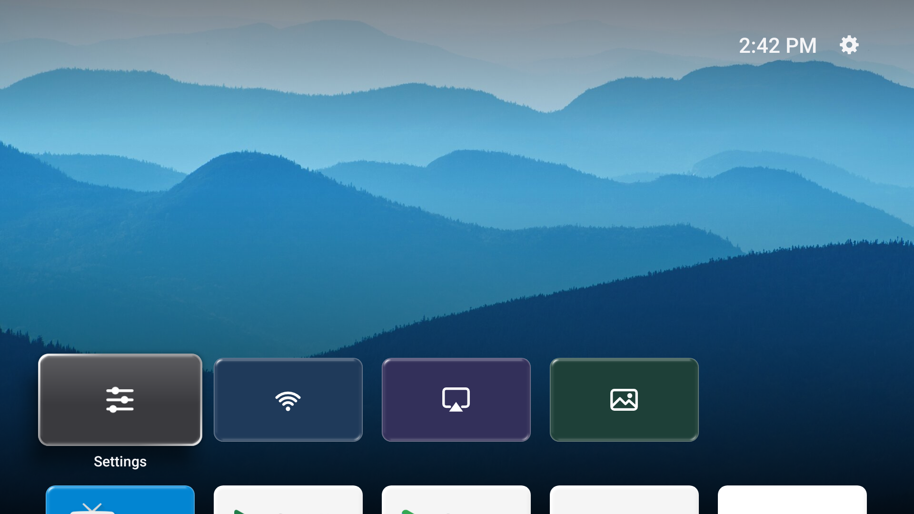
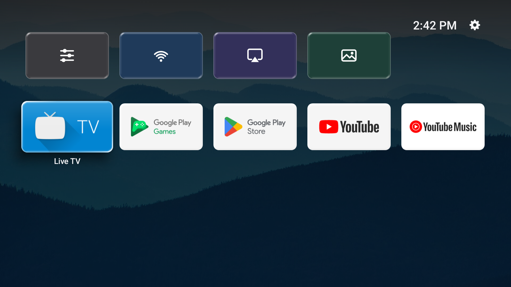
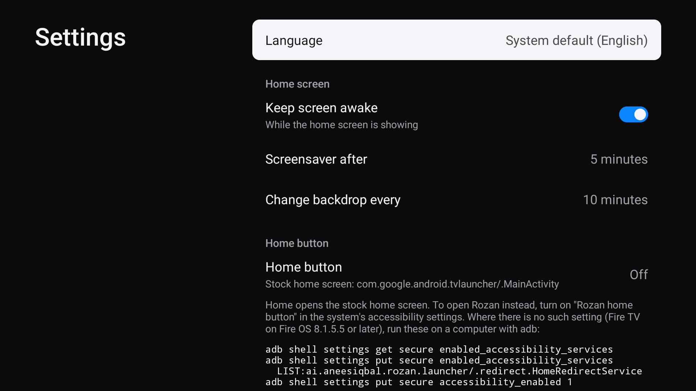
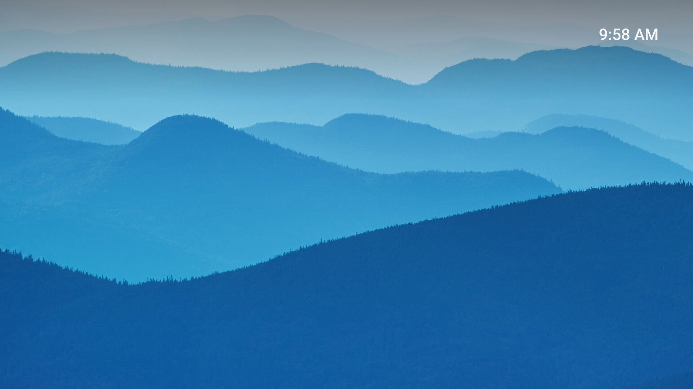
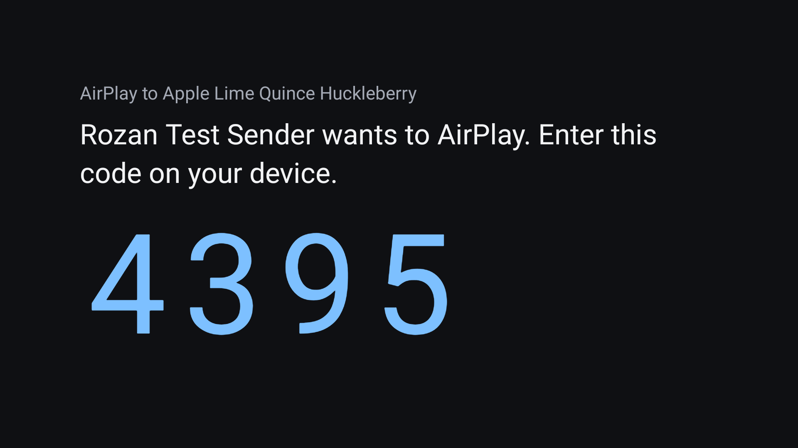

# Rozan

Rozan is a home screen for Android TV and Fire TV with an AirPlay receiver
built in: a Mac or iPhone can mirror its screen to the TV or play audio
through it. It is installed by sideloading, not from an app store.

Languages: English, 简体中文, Français, Italiano, 日本語, Português (Brasil),
Русский and Español.

The receiver is also available on its own as Rozan AirPlay, for keeping
your current home screen.



## Home screen

The first row has tiles for Settings, Network, AirPlay and the screensaver.
Your apps follow in alphabetical order. Press Menu, or hold Select, on an
app for "App info" and "Uninstall". On a TV with HDMI inputs, the Inputs
button next to the gear switches between them, or opens the TV's own input
list where Rozan can't switch them itself.



The backdrop changes between 24 landscape photos that come with the app
([credits](docs/BACKDROPS.md)).

## Settings and screensaver

The gear opens Rozan's settings: the language, keeping the screen awake,
the screensaver delay, how often the backdrop changes, the Home button, and
AirPlay.



While "Keep screen awake" is on, the home screen turns into a slideshow of
the backdrops after 5 minutes without a key press. Any key brings it back.



## AirPlay

On a Mac or iPhone, pick the TV in Screen Mirroring, or as the audio output
in Music. The TV shows a code; type it on the Mac or iPhone and the screen
or the audio comes up on the TV. Every connection gets a new code. Back on
the remote ends mirroring.



Rozan AirPlay is the same receiver without the home screen.


[AirPlay](docs/AIRPLAY.md) has the settings, the limits and the known
issues.

## Install

Rozan's AirPlay receiver has worked with a real Mac and iPhone, but Rozan
has only run on the Android TV emulator so far, not on TV hardware.

It needs Android 9 or later, or Fire OS 7 or later. Download the APK from
the [latest release](../../releases/latest), then, with adb connected to
the TV:

```sh
adb install rozan-launcher-<version>.apk
adb shell appops set ai.aneesiqbal.rozan.launcher SYSTEM_ALERT_WINDOW allow
```

The second command lets the AirPlay code and mirroring show over other
apps. [Installing](docs/INSTALL.md) covers making the Home button open
Rozan, Rozan AirPlay, and going back to the stock home screen.

## Documentation

- [Installing](docs/INSTALL.md)
- [Home screen and settings](docs/LAUNCHER.md)
- [AirPlay](docs/AIRPLAY.md)
- [Backdrop photos](docs/BACKDROPS.md)
- [Security](SECURITY.md)
- [Development](docs/DEVELOPMENT.md)
- [Changelog](CHANGELOG.md)

## License

MIT, see [LICENSE](LICENSE). The ALAC decoder is a port of Apple's
Apache-2.0 reference decoder (`airplay/alac/NOTICE`).
