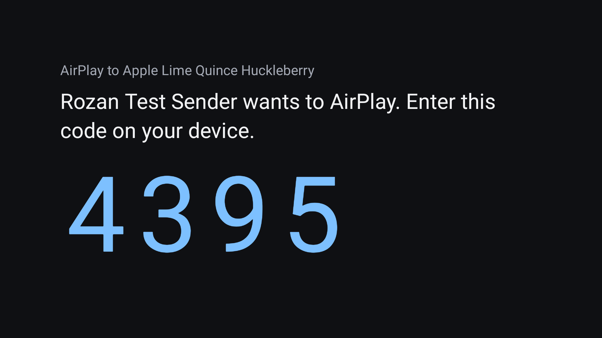
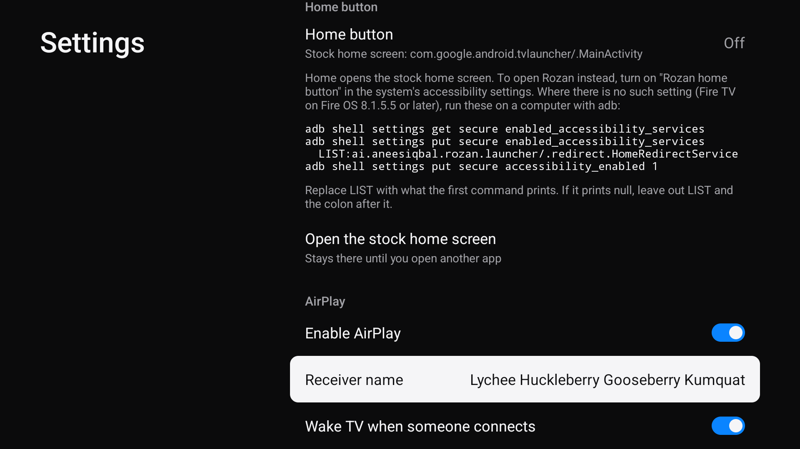

# AirPlay

Rozan's AirPlay receiver lets a Mac or iPhone mirror its screen or play
audio on the TV. It is built into the Rozan launcher, and also comes as a
separate app, [Rozan AirPlay](#rozan-airplay), for people who keep their
current home screen. [INSTALL.md](INSTALL.md) covers installing both.

## What it receives

- Screen mirroring from a Mac or iPhone, with its sound. The picture fills
  the screen, with black bars when its shape differs from the TV's. It is
  at most 1080p at 30 frames per second, also on a 4K TV.
- Audio on its own, such as from the Music app. The TV shows "Playing from"
  and the sender's name, with the title, artist, album and artwork when the
  sender sends them. Back closes that screen and the audio keeps playing.
  That screen does not keep the device awake, so the device's screensaver
  and sleep timer still run.

Videos and photos sent with an app's own AirPlay button, such as a video
player's, are not supported.

## Connecting

1. On the Mac or iPhone, open Control Center > Screen Mirroring and pick
   the TV. For audio only, pick it under Music's AirPlay button instead.
   The TV is listed under its [receiver name](#receiver-name).
2. The TV shows "AirPlay to" and its name, then "*sender* wants to AirPlay.
   Enter this code on your device." and a code. The code appears over
   whatever app is on screen if Rozan may
   [show over other apps](#show-over-other-apps).
3. Type the code on the Mac or iPhone. Music on a Mac asks for it only when
   a track starts, as an AirPlay password.
4. Mirroring takes over the screen, or the audio starts.
5. To stop, end it on the Mac or iPhone, or press Back on the TV remote
   while mirroring.



## Codes

The receiver remembers no devices. Every connection asks for a new code,
and the code is shown only on the TV, so being on the same network is not
enough to connect: the person also has to see the TV.

A code stops working 2 minutes after it appears, or after three wrong tries
(four in Music on a Mac). Starting again on the Mac or iPhone brings a new
code.

## Limits

- One device at a time. While one device is mirroring or playing audio,
  other devices cannot connect; a Mac shows "Unable to connect".
- One code at a time. While one device's code is on the TV, other devices
  that ask for a code are turned away until that prompt ends.
- A device that has asked for three codes in 10 minutes without
  connecting, or has typed many wrong codes, gets no new code for a while,
  at most 10 minutes.

[SECURITY.md](../SECURITY.md#measures) lists every limit and why it is
there.

## Settings

The AirPlay tile on Rozan's home screen opens the AirPlay part of Rozan's
settings. Rozan AirPlay has the same settings on its one screen, under
slightly different names.



| In Rozan | In Rozan AirPlay | Default | What it does |
| --- | --- | --- | --- |
| "Enable AirPlay" | "AirPlay receiver" | On | Turns the receiver on or off. While it is on, the receiver also starts when the device starts. |
| "Receiver name" | "Receiver name" | Four random fruit names | The name Macs and iPhones list. |
| "Wake TV when someone connects" | "Wake TV on connect" | On | Wakes the device when a Mac or iPhone asks for a code. |
| "Show over other apps" | "Show over other apps" | Set over adb | Shows whether the code and mirroring can appear over other apps. |

### Receiver name

On first start the app picks four random fruit names, such as "Blackberry
Kumquat Melon Kiwi", and keeps them until you change the name. A long name
is shortened. An empty name is not saved and the previous name stays;
Rozan's settings then say "The name can't be empty. The previous name was
kept."

### Wake on connect

With this setting on, when a Mac or iPhone asks for a code while the device
is asleep, the device wakes and shows the code. If the TV supports
HDMI-CEC, it turns on with it. A Mac or iPhone that only lists the TV in
its AirPlay menu does not wake it.

### Show over other apps

The code and the mirrored screen appear over any app only when Rozan may
draw over other apps. Without that permission, "The code and mirroring only
appear while Rozan is open." A sideloaded app gets it from a computer with
adb:

```sh
adb shell appops set ai.aneesiqbal.rozan.launcher SYSTEM_ALERT_WINDOW allow   # Rozan
adb shell appops set ai.aneesiqbal.rozan.airplay SYSTEM_ALERT_WINDOW allow    # Rozan AirPlay
```

Both apps show whether it is allowed, and show the command while it is not.

## Rozan AirPlay

Rozan AirPlay is the same receiver without the home screen. It is in the
device's app list, and opening it starts the receiver if "AirPlay receiver"
is on. It follows the device's language and has no language setting of its
own.


Under the name, a status line says whether Macs and iPhones can find the
receiver:

- "Announced on the network": they can.
- "Announcing on the network", or "Running, not announced on the network
  yet": it is starting.
- "Waiting for a network connection".
- "Could not announce on the network. Retries when the network changes."
- "The receiver could not start. Come back to this screen to try again."
- "Port 7000 is in use by another app, so Apple devices cannot connect.
  Close that app and come back to this screen." Rozan with AirPlay on is
  such an app: only one of the two can receive on a device, so turn AirPlay
  off in one of them.
- "Off": "AirPlay receiver" is off.

## NVIDIA Shield

- For wake on connect to turn the TV on, turn on the Shield's setting that
  turns the TV on when the Shield wakes, under Settings > Device
  Preferences > Display & Sound, and HDMI-CEC in the TV.
- On 2019 models, if the mirrored picture lags behind the sender, set AI
  upscaling to Basic.
- If voices are out of step with lips, turn off Dolby audio processing in
  the Shield's sound settings.

## What has been tested

The receiver has mirrored a real Mac and iPhone and played Music from the
iPhone, but so far only while running on a computer, not yet on a Fire TV
or Android TV device, and not with an iPad. Music on a Mac has played only
in a build that skipped the code, so its password prompt has not been
tried; [INTEROP.md](INTEROP.md#results) has the details.

## Known issues

- After a session ends, an iPhone shows "Unable to connect" for about two
  minutes before it asks for a new code.
