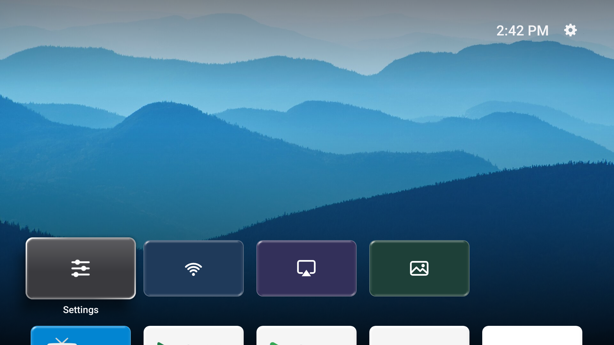
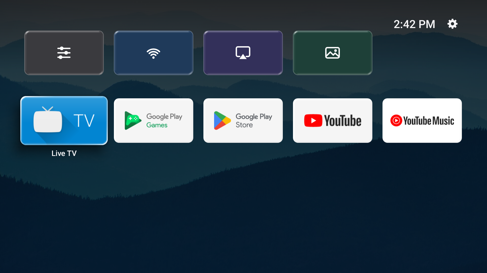
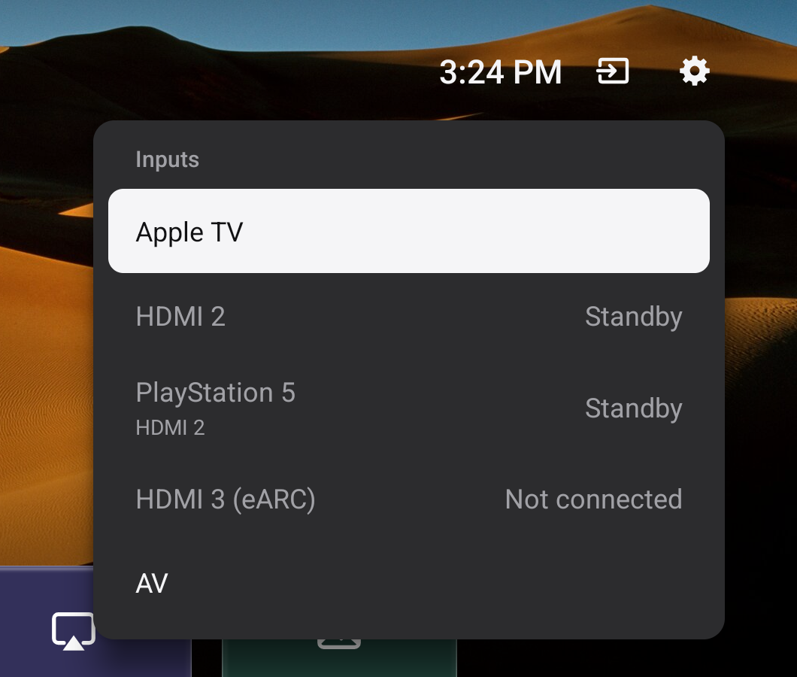
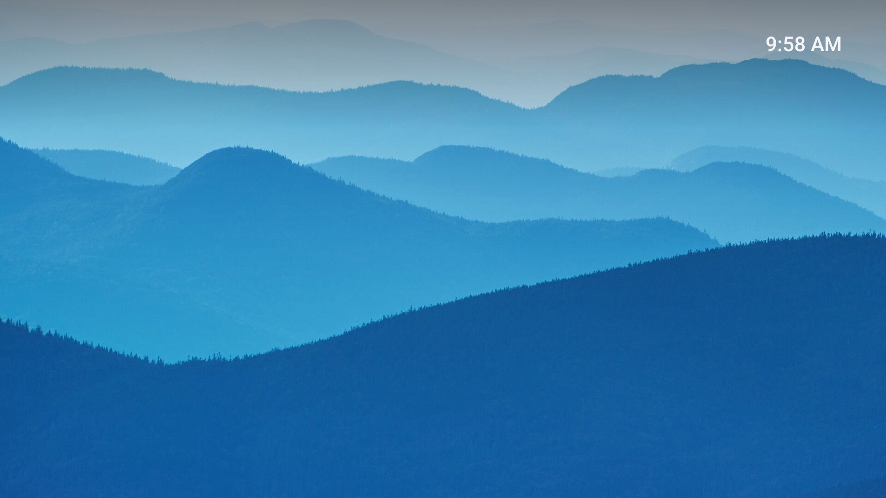
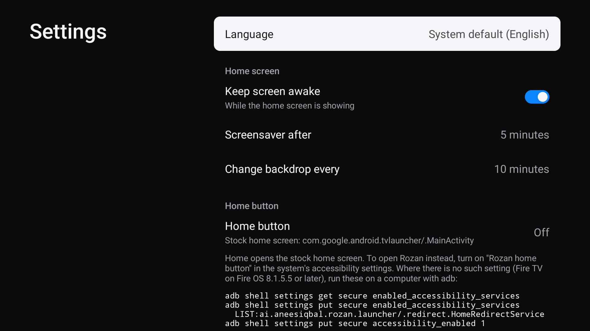

# Home screen and settings

This page describes the Rozan launcher: the home screen, the Inputs button,
the settings, the screensaver and the backdrops. The AirPlay receiver inside
it has its own page, [AIRPLAY.md](AIRPLAY.md). Installing Rozan and making
the Home button open it are in [INSTALL.md](INSTALL.md).

## The home screen

The clock and a gear sit in the top-right corner. The clock follows the
system's 12-hour or 24-hour setting, and the gear opens Rozan's settings.
On some TVs an Inputs button sits between them ([Inputs](#inputs)).

Tiles have a glass edge. The focused tile grows, casts a shadow, shows its
name underneath, and gets a brighter edge and a gloss across its top.

The first row holds four built-in tiles:

| Tile | Opens |
| --- | --- |
| Settings | The system settings. On Fire TV, Fire OS's own settings screen. |
| Network | The system's Wi-Fi settings. On Fire TV, Fire OS's network page, or its settings screen where the network page cannot be opened. |
| AirPlay | Rozan's settings, at the AirPlay section. |
| Screensaver | The screensaver, right away. |

## Apps

- Below the built-in tiles are the installed apps, one tile per app, in
  alphabetical order. Upper and lower case sort together.
- Rozan itself and the system settings app are left out, since the
  Settings tile already opens the latter.
- The grid updates when an app is installed, updated or removed.
- Press Menu, or hold Select, on an app for "App info" (the system's app
  info page) and "Uninstall" (the system's uninstall prompt).
- Back closes that panel or the Inputs list, ends the screensaver, or moves
  back to the first tile. It never leaves the home screen. Pressing Home
  while the home screen is showing also moves back to the first tile.

## Inputs

The inputs in this picture are examples, not a real TV's.

The Inputs button sits between the clock and the gear. What it does depends
on the device:

- On Android TV and Google TV televisions that report their HDMI and other
  video inputs, it opens Rozan's list of the inputs. Selecting one switches
  the TV to it.
- On Fire TV, it opens Fire OS's own input list, where you switch inputs.
  Fire TV Edition and Fire TV Omni TVs and the Fire TV Cube have one; on a
  Fire TV without one there is no button. If the list does not open, Rozan
  shows "This TV doesn't let Rozan open its input list." and removes the
  button until an app is installed, updated or removed.
- Everywhere else there is no button. That includes streaming sticks and
  boxes such as Chromecast with Google TV, the Google TV Streamer and the
  NVIDIA Shield: they have no inputs, and Android gives apps on them no way
  to switch the TV's input.

The Inputs button has not been tried on a real TV or a Fire TV yet.

### Rozan's list

- Select switches the TV to the input. Back, B or Menu closes the list.
- Each input shows the name it was given in the TV's settings, or else the
  TV's own name for it, such as "HDMI 2". HDMI inputs come first, in port
  order, then the other connectors.
- A device that the TV found over HDMI-CEC, such as a game console, is
  listed under the port it is plugged into, with the port's name below it.
- An input whose device is in standby shows "Standby", and one with nothing
  plugged in shows "Not connected". Both are greyed out but can still be
  selected, since many devices wake up when the TV switches to them.
- Inputs hidden in the TV's settings are left out, and so is the TV's
  antenna or cable tuner. Open that from its app tile, such as Live TV.
- The list changes by itself when an input is plugged in, unplugged, wakes
  or goes to standby.
- If the TV does not let Rozan switch, the list says "Rozan can't switch to
  HDMI 2 on this TV." (with the input's name) and, where the TV has its own
  input list, offers "Open the TV's input list".

## Backdrops

The backdrop is one of 24 landscape photos that come with the app, all
public domain or CC0. Rozan does not download photos. Every "Change backdrop
every" interval (10 minutes by default) it crossfades to the next one. Each
round shows every photo once in a new random order, and never the same
photo twice in a row. With animations turned off in the system settings,
the photo changes without a crossfade.

Each photo's title, author, licence and source are in Rozan's settings
under "Backdrop photos" and in [BACKDROPS.md](BACKDROPS.md).

## Keep awake and the screensaver

- "Keep screen awake" (on by default) keeps the screen on while the home
  screen is showing. With it off, the system's own sleep settings apply.
- With "Keep screen awake" on, the screensaver starts after "Screensaver
  after" (5 minutes by default) without a key press on the home screen.
  The tiles and the buttons fade out, leaving the photo and the clock. The
  photo then changes every 45 seconds.
- Any key ends the screensaver. That key does nothing else, so it does not
  also open the focused app.
- The Screensaver tile starts it at once, even with "Keep screen awake"
  off.
- The screensaver runs only on the home screen. Opening another app ends
  it.

## Settings

The gear opens Rozan's settings. Every change is saved at once. Select
turns a switch on or off. On a row with choices (Language and the rows in
minutes), Select moves to the next choice, and Left and Right step back and
forward.

| Section | Setting | Default | Choices |
| --- | --- | --- | --- |
| (top) | "Language" | System default (shows the language it resolves to) | System default, English, 简体中文, Français, Italiano, 日本語, Português (Brasil), Русский, Español |
| Home screen | "Keep screen awake" | On | On, Off |
| Home screen | "Screensaver after" | 5 minutes | 2, 5, 10, 15 or 30 minutes; greyed out with "Turn on Keep screen awake to use the screensaver" while "Keep screen awake" is off |
| Home screen | "Change backdrop every" | 10 minutes | 5, 10, 15, 30 or 60 minutes |
| AirPlay | "Enable AirPlay" | On | On, Off |
| AirPlay | "Receiver name" | Four random fruit names, such as "Lychee Huckleberry Gooseberry Kumquat" | Any name, cut to 63 bytes; an empty name is refused |
| AirPlay | "Wake TV when someone connects" | On | On, Off |

[AIRPLAY.md](AIRPLAY.md) explains the AirPlay rows.

### Language

System default follows the first device language Rozan is translated into,
and English otherwise. Each language is listed by its own name. A change
applies at once to the launcher and to the AirPlay screens and
notification. On Android 13 and later the system's per-app language
settings show the same choice.

### Home button

The "Home button" row shows whether the Home button opens Rozan:

| Value | Meaning |
| --- | --- |
| "Opens Rozan" | Rozan is the system's home app, so Home opens it directly. |
| "On" | The "Rozan home button" accessibility service opens Rozan whenever the stock home screen appears. |
| "Turned on, not running" | The system lists the service as on but has not started it. Turn it off and on again in the system's accessibility settings, or run the adb commands shown. |
| "Off" | Home opens the stock home screen. |

The row also names the stock home screen. While the redirect is off or not
running, the section shows the adb commands that turn it on. Select on the
row opens the system's accessibility settings, except on Fire TV.
"Open the stock home screen" opens the stock home screen and stays there
until you open another app. [INSTALL.md](INSTALL.md) explains the redirect.

### Other rows

- AirPlay: "Show over other apps" reads "Allowed" or "Not allowed". While
  it is not allowed, the adb command that allows it is shown below it.
- About: "Version", "License" (MIT) and "Open-source notices", the
  licences of the libraries Rozan includes.
- Backdrop photos: the title, author, licence and source of each backdrop.

## Game controllers

A game controller works like the remote. A selects, B goes back, and the
left stick and the D-pad move focus. Hold A on an app for "App info" and
"Uninstall"; the controller's Select button opens them too. Y and Start
work like A, and X does nothing outside text fields.

## Fire TV

- Fire TV does not let another app become the default home screen.
  Rozan's optional "Rozan home button" accessibility service opens Rozan
  when the Fire TV home appears. After a Home press, the Fire TV home shows
  for up to 5 seconds on Fire OS 7 and about 250 ms on Fire OS 8 before
  Rozan appears. [INSTALL.md](INSTALL.md) has the commands.
- Fire OS 8.1.5.5 and later do not list the service in their accessibility
  settings, so it is turned on with adb there. The "Home button" row shows
  the commands.
- The Settings and Network tiles open Fire OS's own screens, so the system
  settings stay reachable with Rozan as the home screen.

None of this has been tried on a Fire TV yet.

## NVIDIA Shield

- Home opens the Shield's classic Android TV home, which the "Rozan home
  button" redirect replaces. Rozan can also be made the real default home
  ([INSTALL.md](INSTALL.md)).
- On the 2019 remote, the ≡ button opens the Shield's quick settings and
  does not reach Rozan. Hold Select on an app for "App info" and
  "Uninstall".
- The Netflix and microphone buttons are handled by the Shield, not by
  Rozan.

None of this has been tried on a Shield yet.
